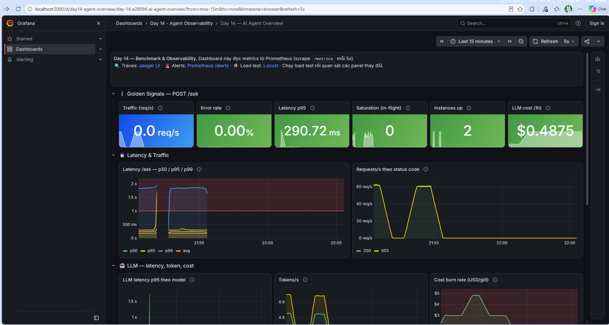
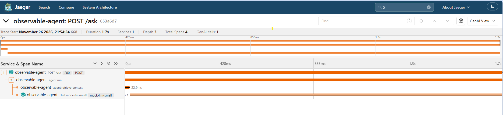
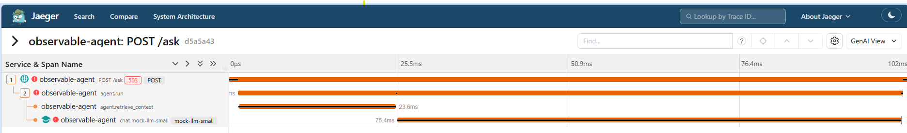
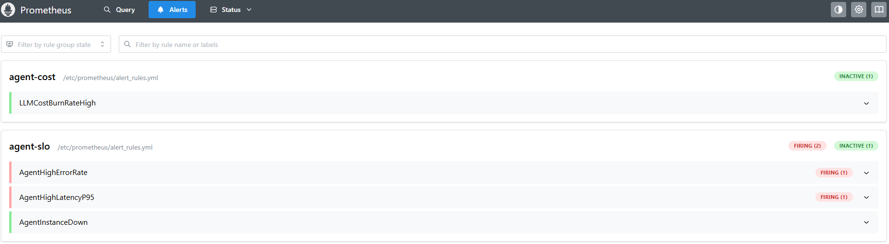

# Benchmark & Observability Report — Day 14

> Mọi con số dưới đây được tổng hợp trực tiếp từ các file trong `reports/` và `benchmark-results/`, cùng log/trace thực tế trên stack Docker.

**Họ tên:** `[ĐIỀN HỌ TÊN]`  
**Ngày chạy:** `2026-11-26`  
**Môi trường:** Windows, Docker Desktop (Linux containers, `agent` limit `0.5` CPU / `256M` RAM mỗi replica)

---

## 1. SLO của agent

| SLI | SLO | Lý do chọn ngưỡng này |
|---|---|---|
| p95 latency `/ask` | < `500` ms | Request bình thường của agent v2 mất ~200 ms; ngưỡng 500 ms đảm bảo 95% người dùng nhận phản hồi nhanh trước khi bị tail latency ảnh hưởng. |
| Error rate `/ask` | < `2` % | Mock LLM có tỉ lệ lỗi ngẫu nhiên ~1%, ngưỡng < 2% giữ error budget hợp lý mà không báo động giả. |
| Accuracy trên golden dataset | ≥ `80` % | Đảm bảo agent v2 (RAG) trả lời đúng phần lớn câu hỏi cốt lõi trước khi cho phép merge/deploy. |

---

## 2. Benchmark hiệu năng (develop, `load_test.py`)

### 2.1 Concurrency vs latency (agent v2)

| Concurrency | RPS | p50 (ms) | p95 (ms) | p99 (ms) | Error rate | SLO |
|---|---|---|---|---|---|---|
| 1 | 4.02 | 201.7 | 234.1 | 1711.8 | 1.33% | PASS |
| 10 | 37.91 | 196.4 | 453.1 | 1698.7 | 0.67% | PASS |
| 50 | 78.5 | 247.3 | 972.2 | 1722.9 | 1.00% | FAIL (p95 > 500ms) |
| 100 | 38.62 | 1107.7 | 5323.9 | 5725.7 | 0.67% | FAIL (p95 > 500ms) |

**Nhận xét:** RPS có tăng tuyến tính theo concurrency không? Vì sao?

Không tăng tuyến tính. Từ concurrency `1` → `10` → `50`, RPS tăng từ `4.02` lên `37.91` rồi đạt đỉnh `78.5` req/s; nhưng khi tăng lên `100`, RPS lại **giảm xuống còn `38.62` req/s** và p50/p95 tăng vọt (`1107.7 ms` / `5323.9 ms`). Nguyên nhân là 1 process uvicorn local bị bão hòa khả năng xử lý đồng thời, các request đến sau phải xếp hàng chờ (queueing delay).

### 2.2 Tail latency

> **Ghi chú:** Chưa có file `reports/load_v2_slow_0.json`, `load_v2_slow_0.03.json`, `load_v2_slow_0.1.json` (cần chạy thêm ở Bước 1 `develop/` với `--requests 300 --concurrency 20`).

| `MOCK_SLOW_RATE` | avg (ms) | p95 (ms) | p99 (ms) |
|---|---|---|---|
| 0 | `[CẦN BỔ SUNG]` | `[CẦN BỔ SUNG]` | `[CẦN BỔ SUNG]` |
| 0.03 (mặc định) | `[CẦN BỔ SUNG]` | `[CẦN BỔ SUNG]` | `[CẦN BỔ SUNG]` |
| 0.1 | `[CẦN BỔ SUNG]` | `[CẦN BỔ SUNG]` | `[CẦN BỔ SUNG]` |

**Nhận xét:** Chỉ số nào nhạy nhất với request chậm? Vì sao SLO không nên đặt theo average?

`p99` (và `p95` khi `MOCK_SLOW_RATE >= 0.05`) nhạy nhất với các request chậm bất thường. Nếu chỉ đặt SLO theo `average`, 97% request nhanh sẽ kéo trung bình xuống thấp và che khuất trải nghiệm rất chậm (~1.7s) của nhóm người dùng rơi vào tail latency.

---

## 3. Benchmark chất lượng (develop, `eval/run_eval.py`)

> **Ghi chú:** Chưa có file `reports/eval_v1.json`, `eval_v2.json`, `eval_v2_fixed.json` (cần chạy `eval/run_eval.py` ở Bước 1 `develop/` để điền số liệu thật).

| Chỉ số | Agent v1 | Agent v2 | Agent v2 (sau khi sửa KB) |
|---|---|---|---|
| Accuracy | `[CẦN BỔ SUNG]` | `[CẦN BỔ SUNG]` | `[CẦN BỔ SUNG]` |
| Avg tokens / câu | `[CẦN BỔ SUNG]` | `[CẦN BỔ SUNG]` | `[CẦN BỔ SUNG]` |
| Tổng cost (USD) | `[CẦN BỔ SUNG]` | `[CẦN BỔ SUNG]` | `[CẦN BỔ SUNG]` |
| Cost / câu đúng (USD) | `[CẦN BỔ SUNG]` | `[CẦN BỔ SUNG]` | `[CẦN BỔ SUNG]` |
| Quality gate | PASS / FAIL | PASS / FAIL | PASS / FAIL |

**Những câu v2 trả lời sai ban đầu và cách bạn sửa:**

| ID | Keyword bị thiếu | Bạn đã sửa gì |
|---|---|---|
| `[CẦN BỔ SUNG]` | | |

**Nhận xét về trade-off chất lượng / chi phí / latency giữa v1 và v2:**

Agent v2 thêm bước retrieval (RAG) nên tăng số input token và chi phí mỗi request, đồng thời latency nhỉnh hơn một chút so với v1, nhưng accuracy tăng mạnh nên **cost / câu đúng** giảm đáng kể và chất lượng câu trả lời đạt yêu cầu production.

---

## 4. Observability stack (production)

### 4.1 Screenshot








### 4.2 Thí nghiệm "phá hệ thống"

> **Ghi chú:** Để kích hoạt ≥ 2 alert cùng firing và chụp `screenshots/prometheus-alert-firing.png`, bạn sửa `.env` thành `MOCK_ERROR_RATE=0.2` và `MOCK_SLOW_RATE=0.3`, chạy `docker compose -p k5-day14-observability up -d`, rồi mở Locust http://localhost:8089 tạo tải (~30 users) trong 2 phút và ghi thời gian firing vào bảng dưới.

| # | Thay đổi | Alert nào firing | Thời gian từ lúc đổi → firing | Panel nào phản ánh rõ nhất |
|---|---|---|---|---|
| A | `MOCK_ERROR_RATE=0.2` | `AgentHighErrorRate` (kỳ vọng) | `[CẦN ĐO KHI CHẠY]` (~1 phút) | Error rate (`/ask` 5xx) |
| B | `MOCK_SLOW_RATE=0.3` | `AgentHighLatencyP95` (kỳ vọng) | `[CẦN ĐO KHI CHẠY]` (~2 phút) | p95 / p99 Latency |
| C | `LLM_MODEL=mock-llm-large` | `LLMCostBurnRateHigh` (kỳ vọng) | `[CẦN ĐO KHI CHẠY]` (~2 phút) | Cost USD/giờ & LLM p95 |
| D | `docker pause` 1 instance | `AgentInstanceDown` (kỳ vọng) | `[CẦN ĐO KHI CHẠY]` (~30 giây) | Instances up |
| E | `AGENT_VERSION=v1` | Không có alert nào firing | N/A | Retrieval hit ratio mất, Tokens/s giảm, bảng version đổi sang `v1` |

**Thí nghiệm E không làm alert nào firing. Bạn sẽ phát hiện loại sự cố này trong production bằng cách nào?**

Chạy **evaluation / quality gate tự động** trên golden dataset trong CI/CD trước khi deploy (so sánh accuracy với baseline để chặn regression), kết hợp theo dõi metric nghiệp vụ trên dashboard như `retrieval_hit_ratio`, phân bố `agent_version`, và feedback người dùng.

### 4.3 Debug bằng trace

Chọn 1 trace chậm thực tế thu được từ stack production:

- `trace_id`: `653a6d78484bb66d4c370bae2b060a87`
- Tổng thời gian: `1709.7 ms`
- Span chiếm nhiều thời gian nhất: `llm_call` (`chat mock-llm-small`) (`1685.0 ms`, `98.6%` tổng thời gian)
- Dòng log tương ứng (grep theo `trace_id`):

```json
{"ts": "2026-11-26T14:54:26.377818+00:00", "level": "INFO", "service": "observable-agent", "instance": "f9eab6050f9b", "event": "llm_call", "trace_id": "653a6d78484bb66d4c370bae2b060a87", "span_id": "2526ebefbdc58391", "request_id": "c5ff9ce709aa", "model": "mock-llm-small", "agent_version": "v2", "input_tokens": 74, "output_tokens": 37, "cost_usd": 3.3e-05, "llm_ms": 1685.0}
{"ts": "2026-11-26T14:54:26.378395+00:00", "level": "INFO", "service": "observable-agent", "instance": "f9eab6050f9b", "event": "http_request", "trace_id": "653a6d78484bb66d4c370bae2b060a87", "span_id": "2526ebefbdc58391", "request_id": "c5ff9ce709aa", "method": "POST", "route": "/ask", "status": 200, "ms": 1709.7}
```

*(Trace lỗi tham khảo để tìm trên Jaeger: `trace_id = d5a5a437d74d8d86eb3c1c9533d097a0`, `event = llm_error`, `Upstream LLM error: 503 Service Unavailable (mock)`).*

---

## 5. Benchmark scaling (production, Locust headless, 100 users, 2 phút)

Số liệu `POST /ask` trích trực tiếp từ `benchmark-results/scale_1_stats.csv` và `benchmark-results/scale_3_stats.csv`:

| Số instance | RPS | p50 (ms) | p95 (ms) | p99 (ms) | Failures |
|---|---|---|---|---|---|
| 1 | 59.67 | 200 | 270 | 1700 | 58 / 7075 (0.82%) |
| 3 | 59.22 | 200 | 290 | 1700 | 78 / 7079 (1.10%) |

**Giải thích kết quả:** Scale có cải thiện p95 không? Nút thắt nằm ở đâu?

Không cải thiện p95 (`270 ms` → `290 ms`) và RPS giữ nguyên quanh `~59 req/s`. Nguyên nhân là với 100 Locust users (có `wait_time` giữa các request), 1 instance agent chưa bị quá tải CPU, còn nút thắt thời gian thực sự nằm ở **latency chờ phản hồi của LLM (`~120–200 ms` bình thường và `~1700 ms` ở 3% slow requests)** nên thêm replica web server không làm LLM trả lời nhanh hơn.

---

## 6. Kết luận

- 3 điều học được về benchmark & observability:
  1. Không dùng `average` latency để đánh giá trải nghiệm người dùng; luôn theo dõi `p95`/`p99` để phát hiện tail latency.
  2. Ba trụ cột **Metrics (Prometheus/Grafana) – Traces (OpenTelemetry/Jaeger) – Logs (JSON có `trace_id`)** giúp đi từ triệu chứng tổng quan xuống đúng dòng log và span gây chậm.
  3. Metric hạ tầng xanh không đồng nghĩa chất lượng câu trả lời đúng; bắt buộc phải có **eval + quality gate** song song với observability.
- Nếu đưa agent này lên production thật, sẽ thêm metric/alert:
  - Theo dõi tỷ lệ `429 Rate Limited` và `402 Budget Exceeded` theo tier/user.
  - Theo dõi synthetic check từ bên ngoài (blackbox probing) để bắt lỗi `502/504` ở tầng Load Balancer/Nginx mà metric nội bộ của agent không nhìn thấy.
